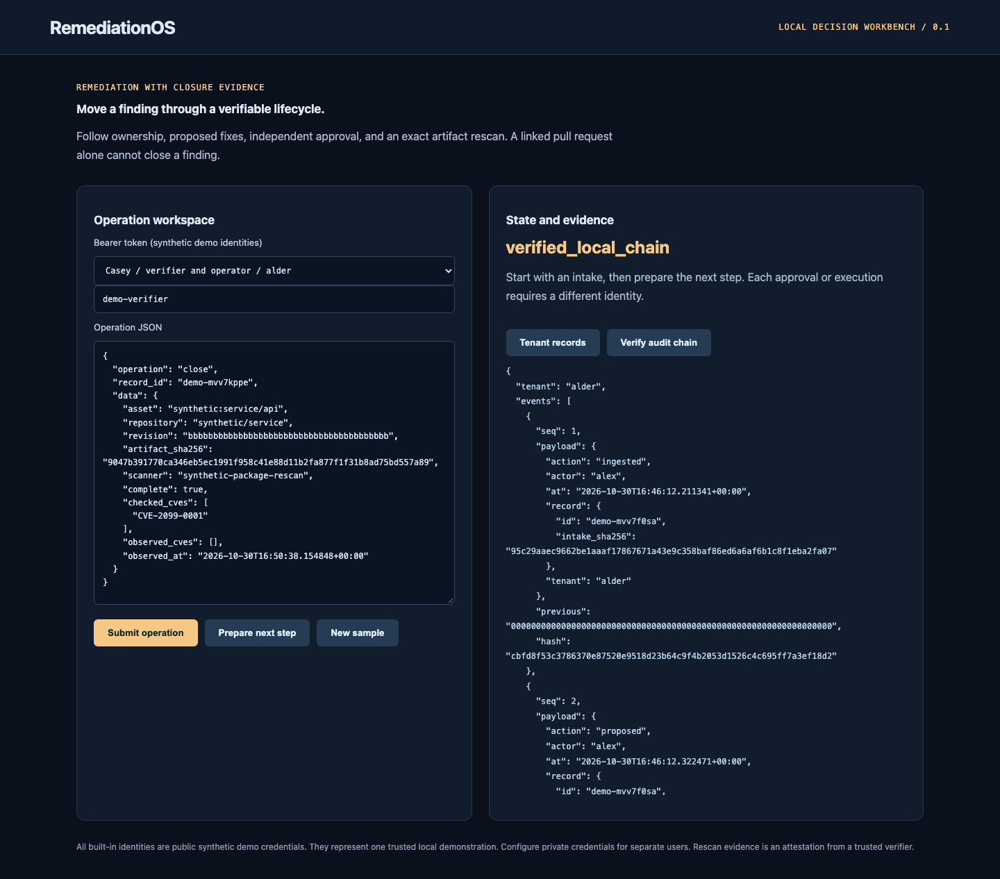

# RemediationOS

[](https://github.com/jayekwere/remediationos/actions/workflows/verify.yml)
[](LICENSE)

**A vulnerability lifecycle with evidence-backed closure.**

A Python FastAPI and SQLite service with a TypeScript workbench. It assigns server-owned repository ownership, calculates CVSS base severity, enriches with dated EPSS and KEV evidence, binds a proposed fix to an artifact, requires independent approval, and checks a fresh rescan before closure.



## Run locally

Requires Node 24.13+ or Node 26, Python 3.14, and a trusted workstation. The initial setup downloads locked dependencies. Afterwards the core synthetic CLI and UI demos work offline. No cloud account or paid service is required.

```sh
git clone https://github.com/jayekwere/remediationos.git
cd remediationos
npm ci --ignore-scripts
python3 -m venv .venv
.venv/bin/python -m pip install --require-hashes -r requirements-dev.lock
npm run build
.venv/bin/python -m app.cli demo
.venv/bin/python -m app.cli serve --demo
```

Open [http://127.0.0.1:8080](http://127.0.0.1:8080). For a container demo, run `docker compose up --build`. Compose publishes only to loopback, uses UID 10001, drops capabilities, denies privilege escalation and makes the root filesystem read-only. A named volume preserves SQLite state; `docker compose down -v` removes demo state. The default network posture is local-only. Do not expose a demo listener as a production service.

## What it enforces

- `open -> proposed -> approved -> closed` transitions are checked inside immediate SQLite transactions. Replayed identical intakes return the existing record; conflicting evidence under the same ID is rejected.
- The authenticated identity supplies tenant and roles. Intake payloads cannot choose an owner or tenant. Repository ownership comes from the operator's tenant map.
- Approval binds the exact proposal digest and requires a subject different from its proposer. Closure requires a third subject with the verifier role.
- Closure binds asset, repository, approved revision, artifact SHA-256, covered CVE, complete scan status and timestamp. A linked PR, empty unscoped report or fresh report for another artifact cannot close a finding.
- The browser's demo rescan calls the actual deterministic fictional-package scanner on an allowlisted file. It does not construct a clean assertion in JavaScript.

## Inputs, integrations and evidence

The synthetic CVE `CVE-2099-0001`, package `synthetic-parser`, EPSS 0.72 and KEV flag are fictional test data, not vulnerability intelligence. The CLI scans both package versions through the same deterministic contract. `samples/fixed.txt` produces no finding and `samples/vulnerable.txt` produces the target finding. This proves the lifecycle's evidence checks on that small local scanner scope.

`app/enrichment.py` imports saved [FIRST EPSS](https://api.first.org/epss/) and [CISA KEV](https://www.cisa.gov/known-exploited-vulnerabilities-catalog) feed shapes, checks coverage/count/date consistency and produces a strict enrichment record. CVSS 3.0/3.1 base scores are computed from a validated vector using the `cvss` package. CVSS, EPSS and KEV answer different questions. Priority is an explicit triage rule: KEV is P0; otherwise EPSS >= 0.5 or CVSS >= 9 is P1; otherwise P2. This is not a calibrated risk model.

`app/github.py` creates an approved PR proposal payload and patch artifact. Its optional read-only `verify_pr` integration binds repository and proposed head through GitHub's API. It never applies a patch, creates a branch, merges a PR or treats merge status as closure evidence. Native PR revision readback has been verified against an existing repository PR, including rejection of a wrong proposed head. No finding or PR was changed during that check. [Native read evidence](docs/live-read-verification.json) also records successful FIRST/CISA feed import; this does not establish an automatic external rescan or real finding closure.

Generated machine output is committed in [samples/output.json](samples/output.json). The [architecture](docs/architecture.md), [threat model](docs/threatmodel.md), [verification record](docs/verification.md), and [distinct scope](docs/portfolio-scope.md) explain the implementation and its boundaries. Strict runtime models are authoritative; published [schemas](schemas) document the contracts. External Terraform and SARIF metadata can carry provider extensions; security-relevant fields receive explicit validation.

## Verify

```sh
# Activate the installed Python environment first.
. .venv/bin/activate
npm run verify
python -m ruff check app tests
python -m mypy app
python -m pytest
npx playwright install chromium
npm run test:browser
docker build -t remediationos:local .
node scripts/container-smoke.mjs remediationos:local
```

CI runs lint, strict TypeScript checks, unit/adversarial tests, measured coverage, builds, the local demo, browser interactions, dependency audit and a hardened container smoke check. Python CI additionally runs Ruff, strict mypy and pytest with an 80% branch-inclusive coverage floor. Every Action uses a verified full commit SHA, checkout credentials are disabled, and the verification workflow has only contents read permission. Browser installation and container builds need network during setup. Artifact retention is 14 days. Repository maintainers control policy and workflow changes.

## Limits and trust

`trusted-ci-attestation` is a trusted verifier's assertion. It is not a cryptographically authenticated CI attestation or an automatic external rescan. The verifier and credential provisioning are part of the trust boundary. The synthetic scanner can close only the fictional synthetic finding; it cannot close an authorized imported real finding.

Native public-feed import and GitHub PR revision readback have been exercised as documented in the read-verification receipt. Real external scanner identity, authenticated CI rescan evidence and cloud response accounts have not been exercised. Saved feed imports preserve provider dates and require fresh evidence, but do not authenticate downloaded feed signatures. CVSS 4.0, full asset discovery, SLA calendars, exception waivers, automated patch application, reopen workflows and distributed task processing are outside this version.

Demo identities are public synthetic credentials, so the demo is not real separation between people. Configured mode requires private bearer credentials and a tenant ownership map. Distinct subjects must represent distinct authorized people. The local hash chain detects inconsistent retained rows; a database owner can rewrite or truncate the entire history. Keep an external checkpoint if stronger integrity is required.

Configured serve mode requires `IDENTITY_FILE` pointing to a private JSON map from random bearer tokens of at least 32 characters to `{tenant, subject, roles}`. It also requires `OWNER_FILE`, mapping tenant to repository to owner. Set `STATE_PATH` for persistent private state. The CLI validates identity file permissions. Direct factory callers own equivalent credential provisioning. Roles are analyst, approver, verifier, operator and viewer; each operation checks its required role. There are no default production credentials.

See [SECURITY.md](SECURITY.md) and [CONTRIBUTING.md](CONTRIBUTING.md). MIT covers this repository's original code; dependencies retain their respective licenses.

The [security audit record](docs/security-audit.json) documents the fragmented request hardening, adversarial regression checks and measurement scope. Offline sample output is unchanged.

---

**AI assistance:** AI tools helped with code or documentation.
