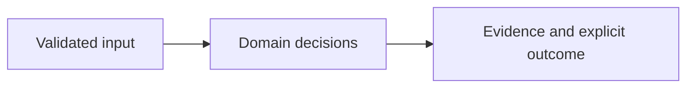

# Architecture

Bearer identity --> tenant ownership --> intake/enrichment --> proposal --> independent approval --> exact artifact rescan evidence --> independent closure --> transactional audit

| Component/source | Responsibility |
| --- | --- |
| `app/api.py:66` | Authenticated operation API and bounded request body middleware |
| `app/common.py:176` | Trusted token-to-tenant/subject/role mapping |
| `app/lifecycle.py:83` | State transitions, owner binding, approval and closure invariants |
| `app/rescan.py:9` | Actual deterministic fictional-package scanner |
| `app/github.py:21` | Optional read-only PR head/repository binding |

## Effective resources

| Deployment or consumer | Configuration and location | Recipients or authority | Enforcing control |
| --- | --- | --- | --- |
| Configured service credentials | IDENTITY_FILE private JSON token map; OWNER_FILE tenant/repository owner map | Server memory and trusted operator | CLI rejects short credentials and group/other-readable identity files; direct factory callers own equivalent provisioning |
| Configured state | STATE_PATH or artifacts/state.db, relative to working directory | Tenant-scoped authenticated actors; server process | SQLite WAL, parameterized composite tenant keys, immediate transactions; database mode 0600; directory must be private |
| Offline demo | Temporary database; samples/vulnerable.txt and samples/fixed.txt | Synthetic demo actors | Actual bounded fictional scanner; fixed clock; temporary state removed |
| Browser demo rescan | Only explicit demo mode; fixed allowlisted samples/fixed.txt | Verifier role | Invokes actual scanner, then closure validates the approved artifact digest; no custom source path |
| PR evidence helper | Fixed https://api.github.com/repos/{repository}/pulls/{number} | GitHub receives operator token | No redirects; exact proposed head and repository match; never authorizes closure |

## Trust and decisions

The identity map supplies tenant and roles, independent of request JSON. Repository ownership is checked against the same tenant. Proposal approval binds its digest and requires a different subject; verification requires a third subject. Closure checks revision, artifact hash, scope, timestamp and absence of the target CVE in an explicitly covered completed scan. External CI evidence is a trusted verifier assertion, not an authenticated CI signature. The synthetic scanner is limited to fictional inputs and cannot close imported real findings.

Core domain decisions are separated from HTTP, CLI and external integration adapters. Runtime models reject unsupported contracts instead of interpreting arbitrary instructions. The UI renders supplied strings with textContent. Container startup uses UID 10001 and loopback publication through Compose. Setup downloads dependencies and optional tools once; core synthetic evaluation does not require a network.

## Unresolved integration scope

Native FIRST/CISA feed import and GitHub PR revision readback have been exercised, as recorded in [live read verification](live-read-verification.json). Automatic feed polling, real external scanner identity and authenticated CI rescan evidence remain outside the implemented scope. There is no automatic patch application. No SSO, credential rotation service, distributed workers or production availability claim. Public demo identities are not separation between real people.

See the README for exact setup, sample outputs, decision semantics and limits. The threat model distinguishes hypotheses from source-established controls.
